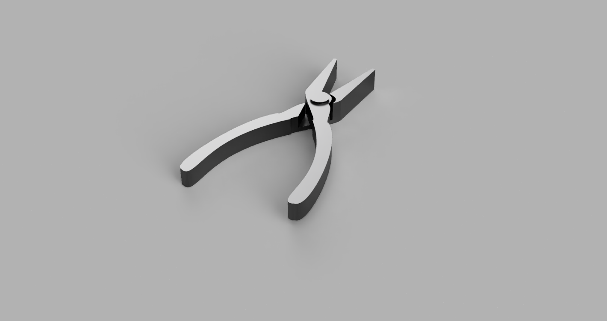
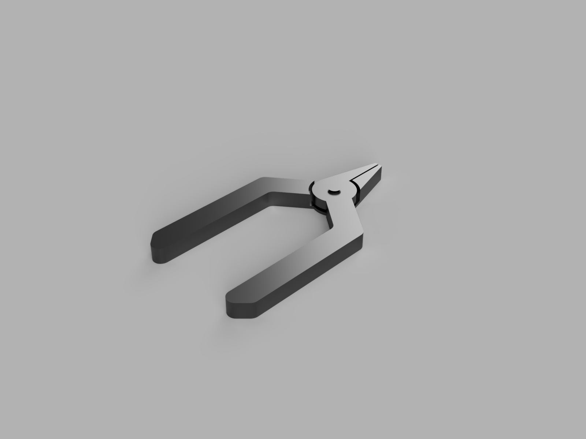
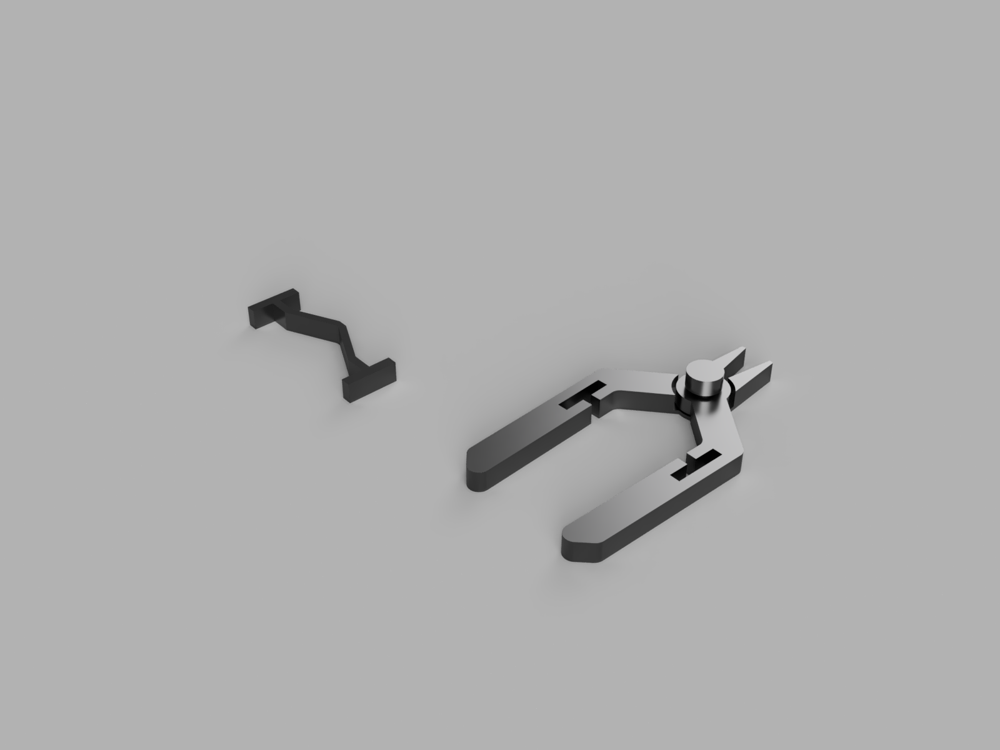
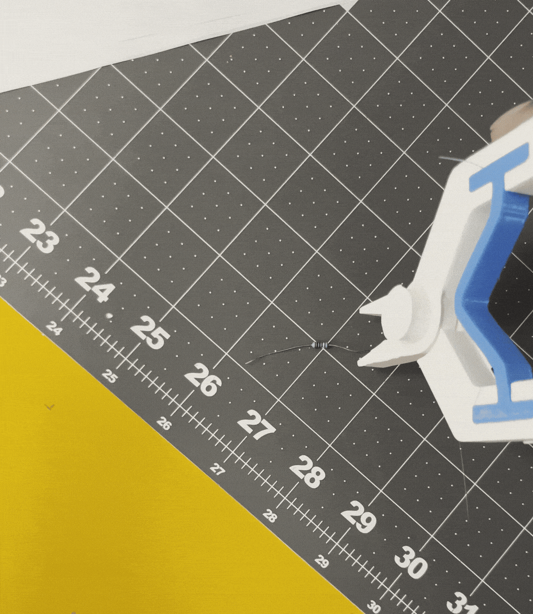

# Redefining Mechanical Prints
**Print-in-place** parts are functional multi-component designs that require no post-printing assembly or manipulation. By printing internal hinges or interlocking joints simultaneously, you can pull a fully moving machine straight off the build plate.

Common applications include:
* **Tools:** [Print-in-place Pliers](https://www.printables.com/model/1161-phonetablet-stand-flat-fold-print-in-place)
* **Consumer Goods:** [Foldable Phone Cases](https://www.printables.com/model/1161-phonetablet-stand-flat-fold-print-in-place) 
* **Mechanisms:** [Planetary Gears](https://www.reddit.com/r/3Dprinting/comments/1m5cwq0/printinplace_planetary_gear/)

## The Solution: Multi-Material Integration
The secret to high-performance print-in-place design is utilizing a flexible element from a second elastomeric material. This ensures the part performs as a true kinetic object with reliable "snap-back" action.

---

# Interactive CAD Model
<iframe src="https://vanderbilt643.autodesk360.com/shares/public/SH90d2dQT28d5b60281150a9839c181a78af?mode=embed" width="640" height="480" allowfullscreen="true" webkitallowfullscreen="true" mozallowfullscreen="true"  frameborder="0"></iframe>

---

# Design & Iterative Process
The goal was to create needle-nose pliers capable of picking up small through-hole resistors, requiring precision and a reliable return spring.

* **Iteration 1:** Used organic splines for ergonomics, but the flared rod pivot failed to print properly due to overhang issues.
* **Iteration 2:** Shifted to blockier handles for better dimensional control. However, the spring geometry was too thick to compress effectively.
* **Final Design:** Moved to a three-component assembly with a cap-style pivot. The TPU spring was thinned for effortless "spring-back" operation.

---

# Technical Specifications & Print Settings

### **Tool Dimensions**
* **Jaw Type:** Needle Nose
* **Jaw Length:** ~ 26 mm
* **Jaw Capacity:** ~ 37 mm

### **Material Specifications**
* **Primary Body:** PLA (Rigid)
* **Spring Component:** TPU (95A Elastic)

### **Print Configuration**
| Part | Nozzle | Infill | Supports |
|:---|:---|:---|:---|
| **Rigid PLA** | 0.4 mm | 20% | None |
| **Elastic TPU** | 0.6 mm | 15% | None |

---

# Gallery & Operation

### Iteration History
  
*Initial spline-based ergonomic concept.*

  
*Second iteration focusing on dimensional accuracy.*

  
*Final multi-material design with optimized TPU spring.*

### Functionality Demonstration
  
*GIF showing the spring-back action and jaw precision.*

---
