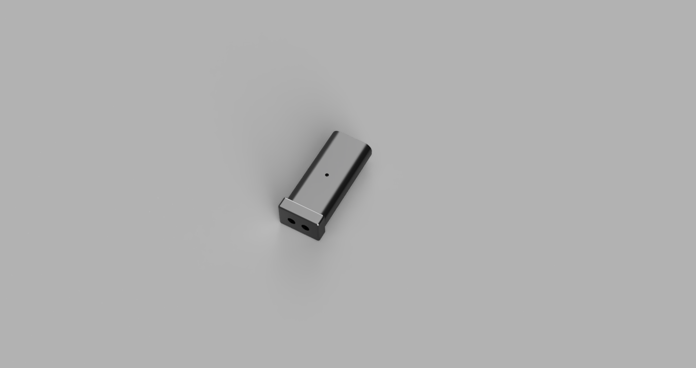
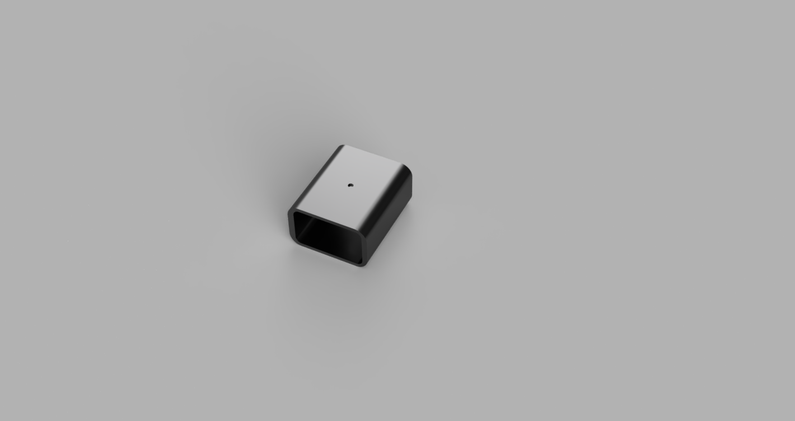
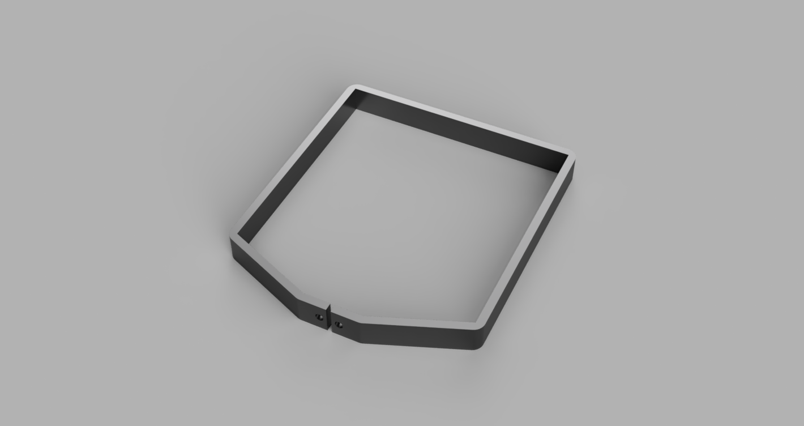
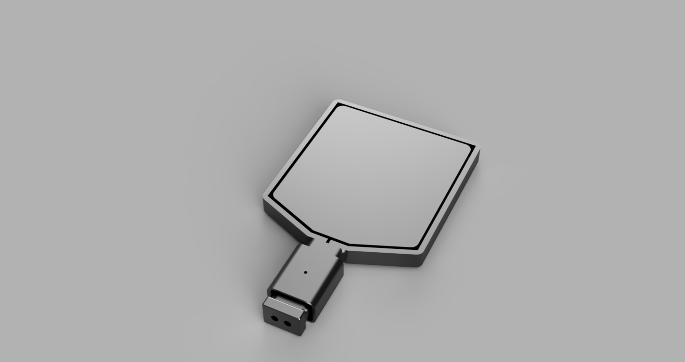

## Introduction to the Project

Pickle ball is a racket-based sport with badminton court dimensions, ping-pong style paddles, and a perforated plastic ball. It is a game of many rules designed like a hybrid version of badminton and life-size table tennis for individuals with weaker joints. For this design project, the goal was to design a pickle ball paddle board that met the 2026 USA Pickleball rules and performed well in a game environment. 

## Main Paddle Board and Dimensions

The paddle of the entire design is approximately 230mm long, 230mm wide, and 25mm thick. This fits the rule requirement of the paddle of a maximum length of 43.18cm, while still providing an adequate surface area for hitting the plastic ball. Ideally this portion of the paddle should be printed in a rigid material with sturdy mechanical properties such as ABS carbon fiber or nylon filament. 

At the bottom of the paddle are two holes for M5 heat set inserts for the handle to screw in. The two M5 screws are inserted orthogonal to the plane of impact to distribute and help absorb the load of impact from the paddle ball. This orientation is superior to the alternative, which would be the screws running from the front to the back of the paddle board, parallel to the direction of the load from impact. 

The handle bar portion of the paddle board is 50mm by 35mm by 120mm. Even with the tpu guard, these dimensions allow the paddle to still adhere to the rule of the length and width when all components are equipped being less than 60.96cm. The total length of my paddle board is 37.6cm and the total width is 22.4cm. This portion should be printed from the same material as the paddle. 

<figure style="margin: 30px auto; text-align: center; width: 95%;">
  

    
    

      
    

    

      
    

  

  <figcaption style="margin-top: 12px; font-weight: bold; color: #333;">
    Figure 1: Main Paddle Board and Orthogonal Screw Assembly.
  </figcaption>
</figure>

## Interchangeable TPU Grip and Guard

This paddle features an interchangeable TPU grip for improved handling and grip of the board. The grip is 5mm thick and extends around the middle portion of the handle. This specific thickness was chosen because it sits as a sweet spot between cushioning the handle and reducing hand fatigue while still being small enough to fit in a hand. On top of that the user can still experience feedback with the added shock absorption at this thickness. 

It can be secured to the handle using a single M5 screw that inserts into the main handle. This aspect of the design provides a solid twist-free grip placement that keeps it in place during aggressive swings and movements. It also makes the handle extremely modular as the grip can be quickly taken off and cleaned or replaced. This opens the possibilities to experimenting with grips of different sizes or TPU flexibilities. 

<figure style="margin: 30px auto; text-align: center; width: 95%;">
  

    
    

      
    

    

      
    

  

  <figcaption style="margin-top: 12px; font-weight: bold; color: #333;">
    Figure 2: Interchangeable TPU Grip and Edge Guard.
  </figcaption>
</figure>

Another feature of this paddle board is an interchangeable TPU guard for the main paddle. The guard is designed to wrap around the exterior of the paddle board and it is supposed to be mounted via the same screws that run from the handle into the base of the board. TPU was chosen as a material to absorb the majority of the force experienced by this guard as it hit the ground. Additionally it is meant to be easy to swap out and change just like the TPU hand grip. The guard is approximately 7mm thick. This was determined as a good starting point for finding a balance between shock absorption, and the weight of the tpu guard affecting the inertia and swing of the paddle and its feel.

<figure style="display: block; margin: 30px auto; width: 70%; text-align: center;">
  
  <figcaption style="margin-top: 10px; font-weight: bold;">
    Figure 3: Final Render of the fully assembled paddle device.
  </figcaption>
</figure>
