## Introduction to Top-Down Modeling

Top-down modeling is a design methodology where the assembly is defined first and then the individual components within the assembly are worked down to. Top-down modeling is a powerful design approach because it allows the designer to create a framework that dictates the shape, size, and position of every part within the context of the whole instead of building parts in isolation and struggling to ensure proper fitting and compatibility.

## Project Overview

The design goal of this project was to design a phone holder that can be mounted to a bike handlebar. In this design project, top-down modeling was utilized and critical as my design had many components and moving parts that would have been difficult to properly fit and size if designed independently.

## Base and Pivot Mechanisms

My design can be mounted to a handlebar of 23-25mm using a screw-based clamping mechanism. I decided to utilize a screw-based clamping mechanism because it ensures that the user can apply adequate friction between the handlebar and clamp to properly secure the phone holder. 

<figure style="margin: 30px auto; text-align: center; width: 95%;">
  

    
    

      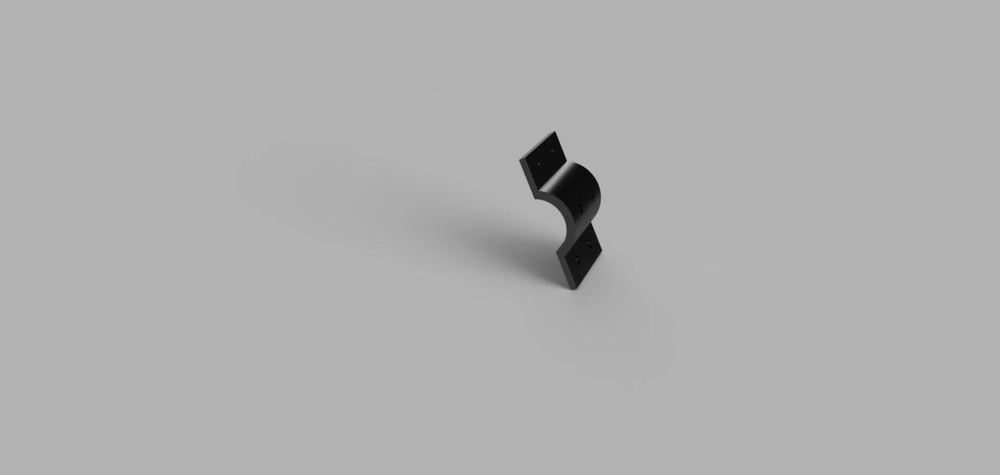
    

    

      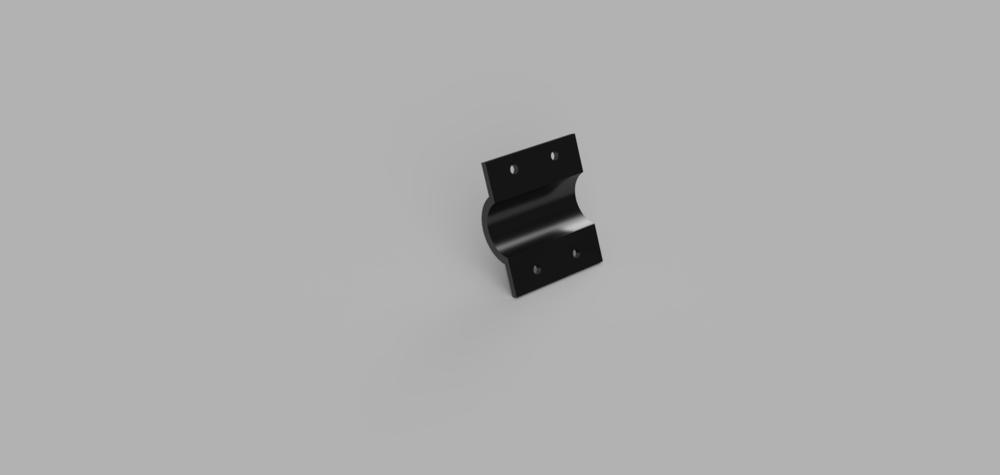
    

  

  <figcaption style="margin-top: 12px; font-weight: bold; color: #333;">
    Figure 1: Bike Mount Mechanism Components.
  </figcaption>
</figure>

Moving upwards from the clamping mechanism, my design features a rotating pivot that allows the user to manipulate the vertical angle of the phone. The ability to adjust the vertical angle of the phone is convenient as it allows the user to adjust for glare, height, and more. This mechanism is mainly secured using the friction between a screw, supporting components, and a nut. This friction allows for firm control of the angle but also prevents the component holding the phone from falling during rougher rides.

<figure style="margin: 30px auto; text-align: center; width: 95%;">
  

    
    

      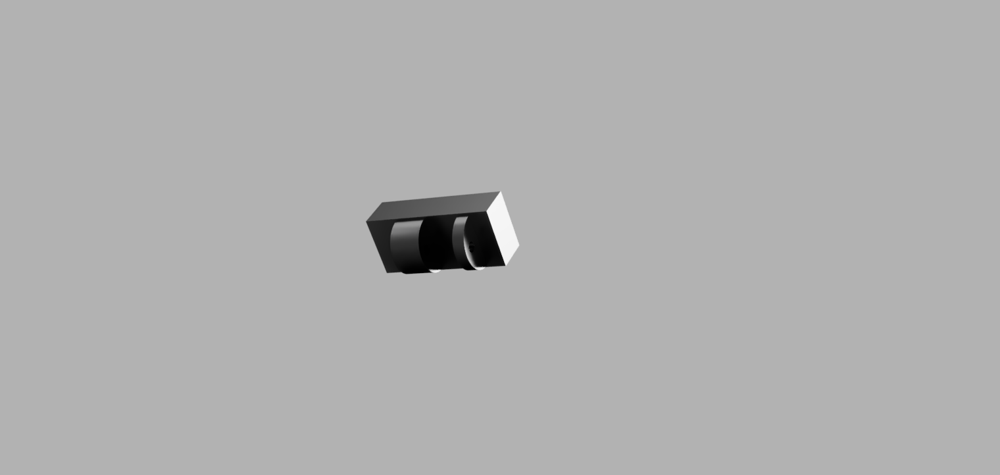
    

    

      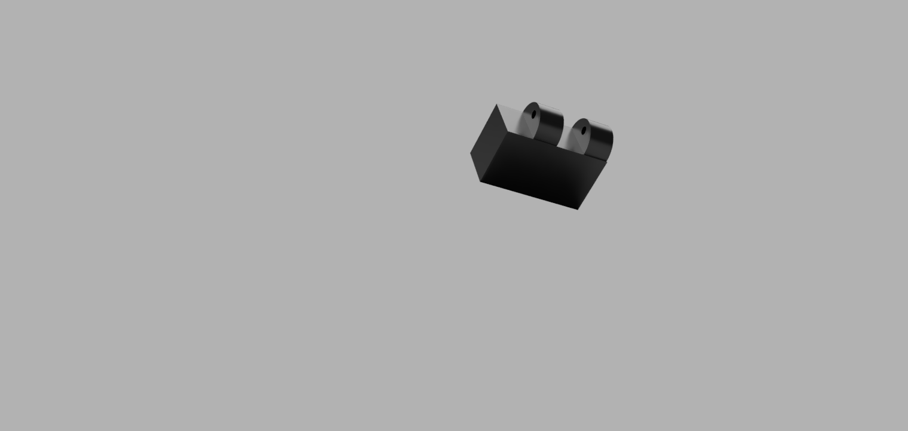
    

  

  <figcaption style="margin-top: 12px; font-weight: bold; color: #333;">
    Figure 2: Swivel Mechanism Components.
  </figcaption>
</figure>

## Phone Support and Detent Mechanism

Moving upward from the base of the phone holder into the main section, the supporting platform for the phone features a lip on the bottom for added support to reduce the load of the horizontal clamps. This platform is designed so that the horizontal clamps do not overlap with the volume buttons, as this can cause issues with accidentally adjusting volume, power, or the ringer button. 

Moving to the back of the support platform are the two most important mechanisms in the design: the detent mechanism and the clamping mechanism. 

* **Phone-Clamping Mechanism:** This is spring-actuated, using a set of screws to clamp a spring to each inner edge to provide the clamping force to hold the phone in place. Additionally, this mechanism features a horizontal bar to act as a rail to keep the mechanism stable. At the end of this horizontal bar is a screw and a nut to provide a horizontal limit. The entire phone-clamping mechanism is designed to fit the base and Pro models of the iPhone 13 lineup and newer. It is also designed with bulky cases in mind. 

<figure style="margin: 30px auto; text-align: center; width: 95%;">
  

    
    

      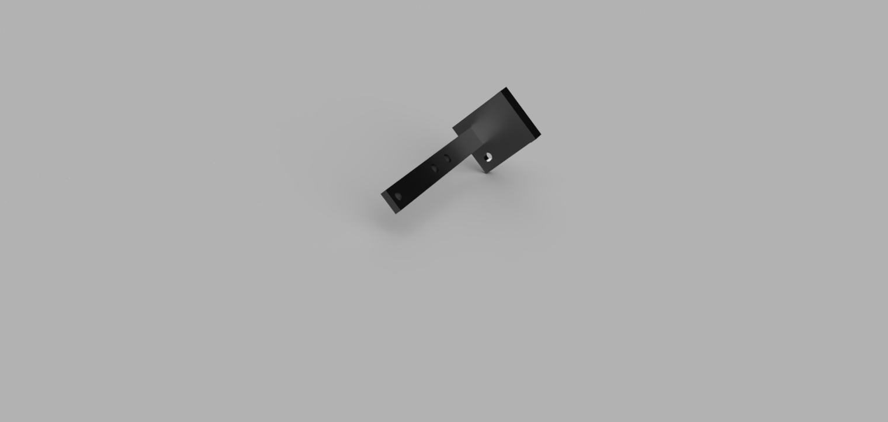
    

    

      
    

      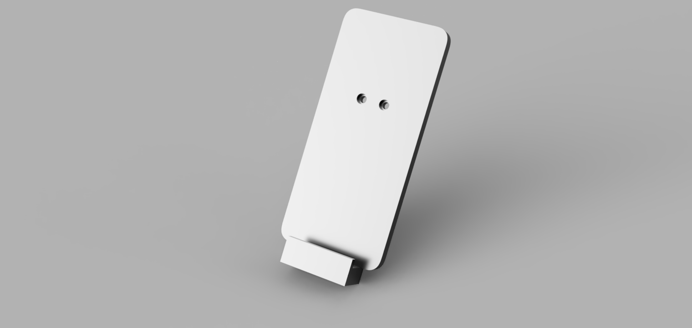
    

  

  <figcaption style="margin-top: 12px; font-weight: bold; color: #333;">
    Figure 3: Phone Clamping Mechanism.
  </figcaption>
</figure>

* **Detent Mechanism:** This exists to allow the phone to rotate 360 degrees in the horizontal direction. This is convenient for users who may want to utilize their device in landscape mode for consuming content. The detent mechanism features a 7mm ball bearing and a corresponding spring that fits into a pocket where the base attaches to the support platform. This mechanism clicks into place at predetermined slots, creating a smooth but sturdy user experience that is resistant to vibrations.

<figure style="margin: 30px auto; text-align: center; width: 95%;">

  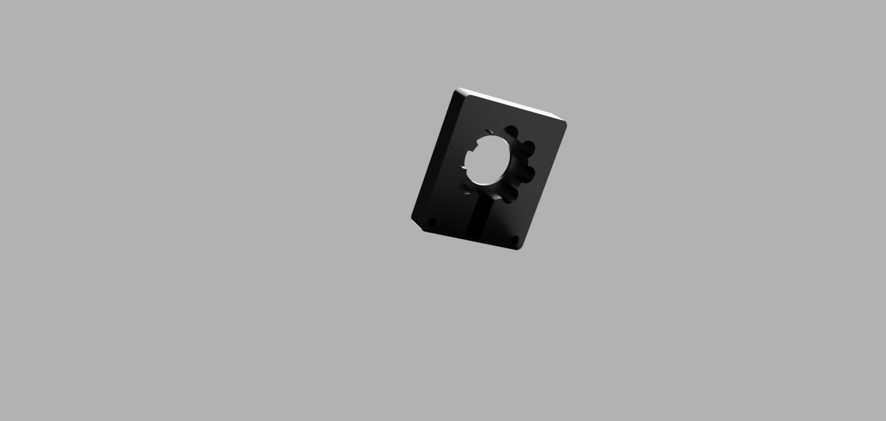

  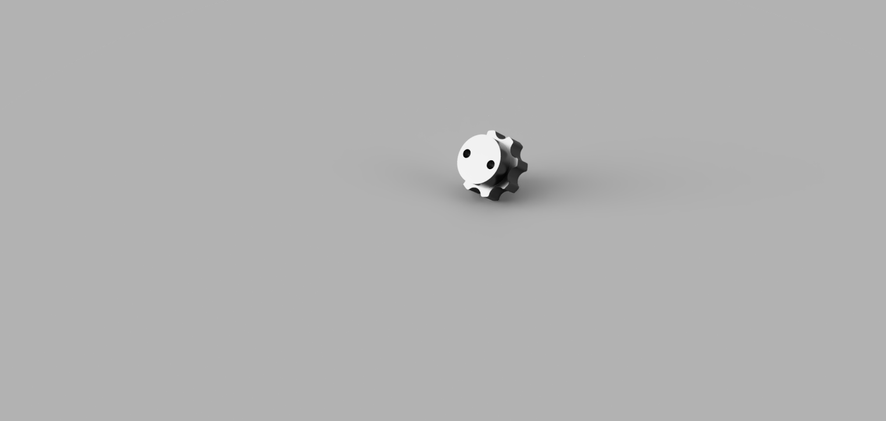

  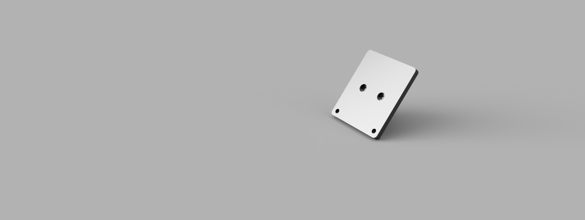

<figcaption style="margin-top: 12px; font-weight: bold; color: #333;">
Figure X: Detent Mechanism Components.
</figcaption>
</figure>

<figure style="display: block; margin: 30px auto; width: 70%; text-align: center;">
  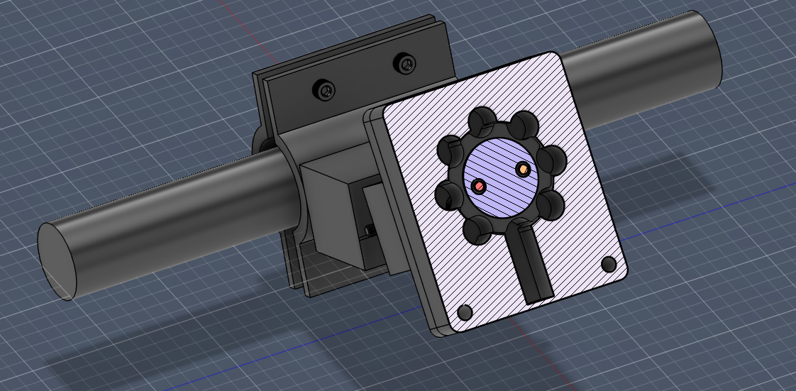
  <figcaption style="margin-top: 10px; font-weight: bold;">
    Figure 3: Cross Section of the Detent.
  </figcaption>
</figure>

## Manufacturing & Rapid Prototyping

My design was filament printed using PLA plastic. This aspect of the design approach was due to the necessities needed for rapid prototyping and multiple iterations. As a result, a lot of the holes for heat-set inserts and screws had to be expanded to account for swelling during the printing process. Pictures of the mount can be seen in action below:

<figure style="display: block; margin: 30px auto; width: 70%; text-align: center;">
  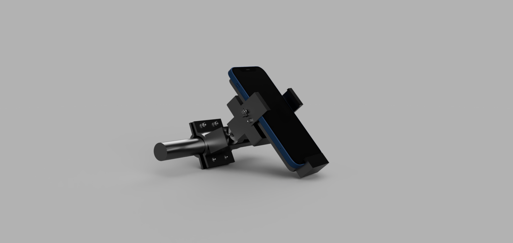
  <figcaption style="margin-top: 10px; font-weight: bold;">
    Figure 4: Final Render of device in use.
  </figcaption>
</figure>
<figure style="display: block; margin: 30px auto; width: 70%; text-align: center;">
  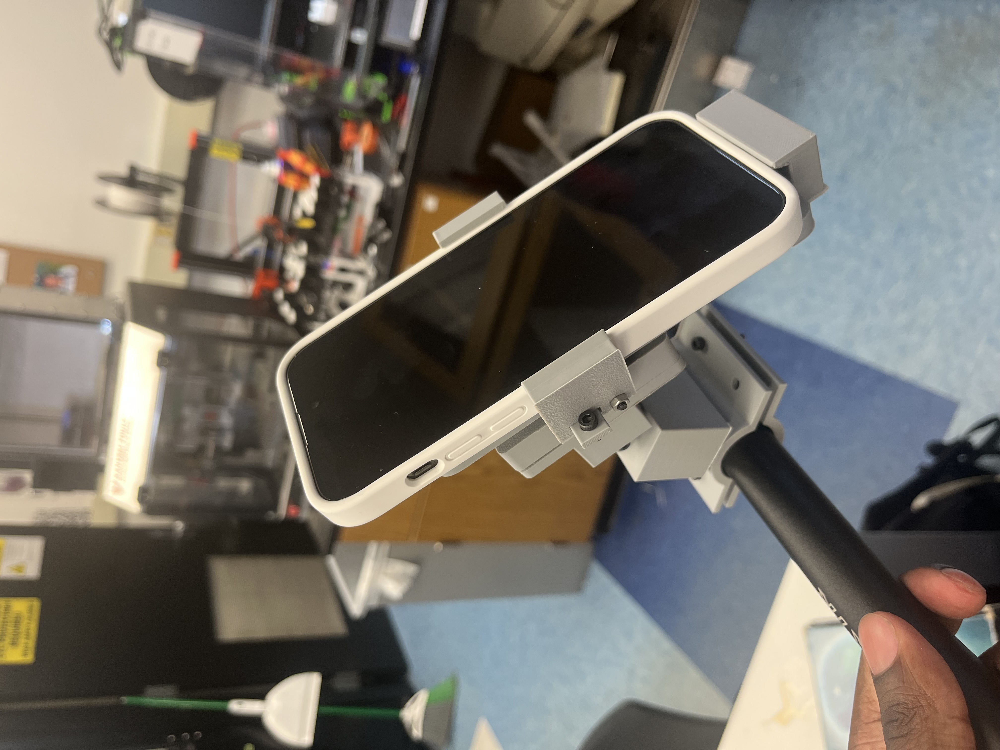
  <figcaption style="margin-top: 10px; font-weight: bold;">
    Figure 4: Device in use.
  </figcaption>
</figure>

<figure style="display: block; margin: 30px auto; width: 70%; text-align: center;">
  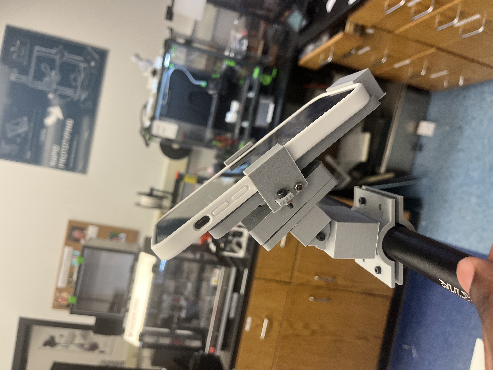
  <figcaption style="margin-top: 10px; font-weight: bold;">
    Figure 4: Horizontal profile of device in use.
  </figcaption>
</figure>
# Instructions For Use
To use this device it must first be secured to a bike-mount using a 2.5 size Allen Key and 16mm M3 screws and nuts. Screw in the M3s diagonally until the the phone holder is securely mounted onto the bike. Next insert phone into the phone clamp by pulling clamp horizontally. Ensure the clamp is applying pressure to the phone before riding bike. Rotate phone to desired orientation. Enjoy!
# Interactive Fusion Model
<iframe src="https://vanderbilt643.autodesk360.com/shares/public/SH90d2dQT28d5b602811b7dab559fbd10b2e?mode=embed" width="640" height="480" allowfullscreen="true" webkitallowfullscreen="true" mozallowfullscreen="true"  frameborder="0"></iframe>

# GIF of Working Model in Action
<figure style="display: block; margin: 30px auto; width: 80%; text-align: center;">
  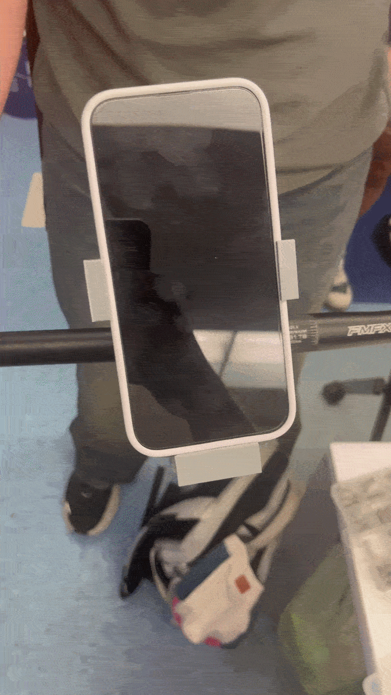
  <figcaption style="margin-top: 12px; font-weight: bold; color: #333;">
    Figure 4: Video of the phone mount model in action.
  </figcaption>
</figure>
