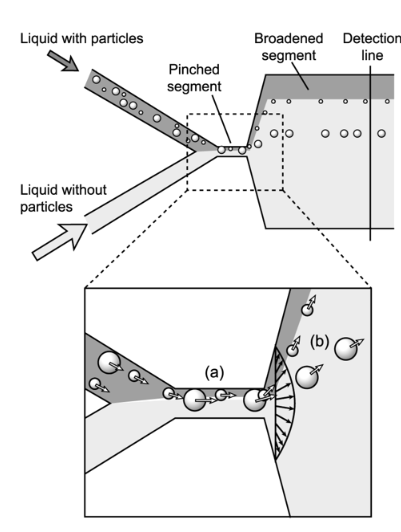
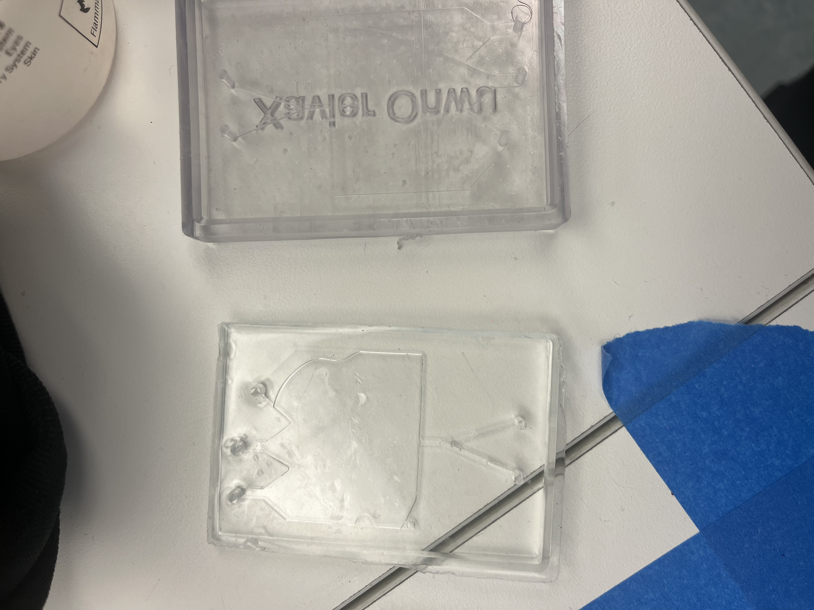
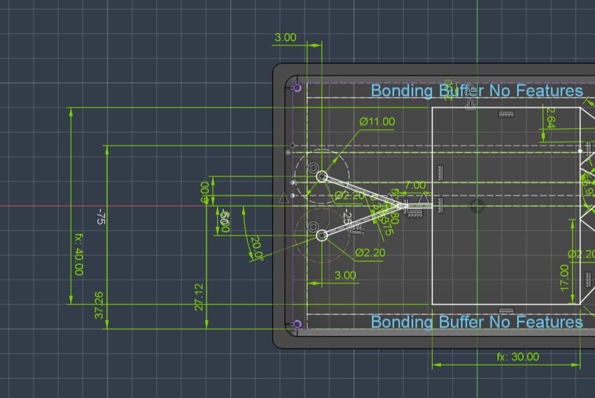
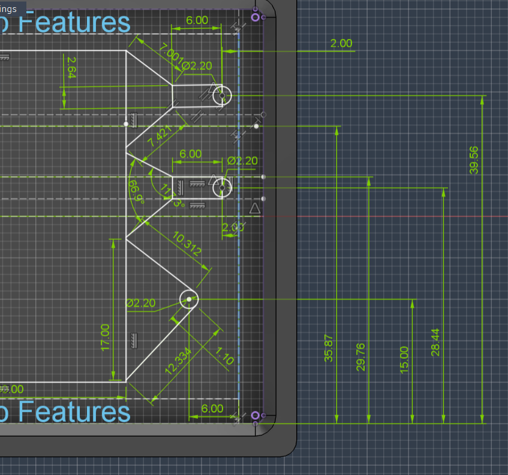
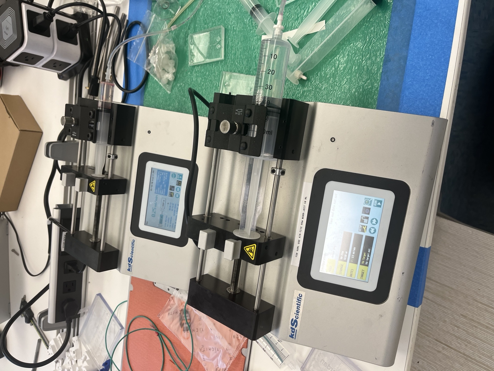

## Introduction

A significant application of high-resolution resin printing is the manufacturing of molds for microfluidic devices. Microfluidic devices are systems that manipulate extremely small amounts of fluid utilizing varying channels to separate particles of varying size. A typical design approach to microfluidic devices is Pinched Flow Fractionation. In this approach particles in a liquid are introduced to a pinched segment of a microchannel where they are aligned to one sidewall of the segment by another liquid without particles being injected into the same pinched segment. 

The particles are separated perpendicularly to the flow of direction according to their size by the spreading flow profile inside the microchannel. Exit channels are then used to extract the separate particles [(Yamada et al., 2004)](https://pubs.acs.org/doi/10.1021/ac049863r). Pinched flow fractionation has advantages over traditional filtration methods like filters due to low risk of clogging, continuous processing instead of batches, and low shear stress being inflicted on the particles being tested. 

<figure style="text-align: center;">
  
  <figcaption>Figure 1: Pinched Flow Fractionation principle.</figcaption>
</figure>

## Device Applications

In this project we designed a microfluidic device using symmetric pinched flow fractionation. This design approach to microfluidic devices can be applied to separating cells, biological particles, blood components, sperm, fungal spores and more [(ScienceDirect)](https://www.sciencedirect.com/science/article/abs/pii/S0255270124004252). In this paper it was used to separate [cancer cells from white blood cells](https://pubmed.ncbi.nlm.nih.gov/26510401/). 

Resin printing was chosen as the additive manufacturing method due to its versatility in materials and more importantly ability to print fine details accurately which is absolutely essential in this project. This specific design also utilizes a glass slide bonded to the perimeter of the device to prevent leaking.

## Instructions for Manufacturing

The manufacturing process for the microfluidic device created in this project involves designing the device in CAD, resin printing a mold, and then fabricating the device using Polydimethylsiloxane (PDMS). Resin printing was chosen as the mold fabrication method due to its versatility in materials and more importantly ability to print fine details accurately which is absolutely essential in this project. This specific design also utilizes a glass slide bonded to the perimeter of the device to prevent leaking. PDMS is ideal for microfluidic devices because it is generally non-toxic, inert, and offers desired physical properties such as flexibility, transparency, and biocompatibility. The most important steps for creating this device were:

* **CAD and Software Preparation:** The design geometry is precisely calculated using the methods described in the design geometry section. This involves proper selection of layer thickness and resolution in PreForm. It was also imperative to ensure that the design was printed perfectly flat to ensure adequate adhesion to the glass slide.
* **Resin Printing and Post-Processing:** The mold is then resin-printed. Post-processing of this design was also critical, involving a thorough IPA wash and brief UV cure to prevent warping. 
* **Parylene Coating:** Before casting the PDMS the resin-printed mold is coated with parylene to address the chemical incompatibility between the resin and PDMS. Unreacted monomers and photo initiators in the resin can cause cure inhibition in the PDMS resulting in a failure of the PDMS to mold to fine features. 
* **PDMS Casting:** The PDMS is then cast to the mold and allowed to fully cure. 

<figure style="display: block; margin: 20px auto; width: 60%; text-align: center;">
  
  <figcaption style="margin-top: 8px; font-style: italic; color: #555;">
    Figure 2: Plasma-Treating PDMS Molding.
  </figcaption>
</figure>

<figure style="display: block; margin: 20px auto; width: 60%; text-align: center;">
  
  <figcaption style="margin-top: 8px; font-style: italic; color: #555;">
    Figure 3: Device and Mold.
  </figcaption>
</figure>
## Design Geometry

The device was designed around separating particles into two categories, 125-150 um, and 425-500 um. The design philosophy for the device geometry started by making the pinch segment 800 um wide providing sufficient clearance to prevent the largest particles (500um) from clogging while still pinning all particles against the upper wall sidewall. The following portion of the device is the main chamber which as a width of 40 mm (measurement is classified as wb). 

This drastic expansion is intentional as it allows for the use of a streamline mapping equation defined as Y0 = (wp-D/2)(wb/wp), where wp is the width of the pinched point, wb is defined previously, D is the diameter of the target particle, and Y0 is the assumed height of the particle. Using this equation, it was calculated that the 125-150 um particles will stabilize at a Y0 center of 36.56 mm, while the larger group of 425-500 um particles will center at 28.44mm.

To properly capture these particles, both exit holes were centered at their respective heights, and the channels were made 2.64mm wide to account for at least 1.5x the radius of the largest possible to prevent clogging. This also was implemented to try and achieve equal flow rate between the two channels. Both outlets were fed by trapezoid shaped openings to account for collisions and small error. To prevent clogging and balance flow rate a bottom buffer outlet of similar width to the first two trapezoid outlets combined was incorporated. 

<figure style="display: block; margin: 30px auto; width: 70%; text-align: center;">
  
  <figcaption style="margin-top: 10px; font-weight: bold;">
    Figure 4: Design Sketch.
  </figcaption>
</figure>

<figure style="display: block; margin: 30px auto; width: 70%; text-align: center;">
  
  <figcaption style="margin-top: 10px; font-weight: bold;">
    Figure 5: Design Sketch.
  </figcaption>
</figure>
## Testing and Results

The results of testing highlighted a fundamental flaw in the design of the device. The channel width corresponding to the smallest particles was too large to provide adequate and balanced fluid flow. By making that channel twice as big as it mathematically needed to be (1.296mm), its fluidic resistance was reduced affecting Y0 sorting. This manifested in testing as a considerable amount of particles both large and small drifting upwards above the target Y0 value. Additionally in practice, the separation between particles was not as drastic as desired and the ratio wb could have been increased. 

  <figure style="text-align: center; width: 32%;">
    
    <figcaption>Figure 6: Fluid Pumps for Buffer and Particles.</figcaption>
  </figure>

  <figure style="text-align: center; width: 32%;">
    
    <figcaption>Figure 9: Device.</figcaption>
  </figure>

  <figure style="text-align: center; width: 32%;">
    
    <figcaption>Figure 8: Suction Pumps to balance flow rates.</figcaption>
  </figure>

If this design were to be scaled up or modified to handle a wider range of particle sizes, multiple sorting stages could be cascaded together, or the expansion ratio could be further increased to spread out the streamlines even more. However, there are factors that set a lower limit on the particle size that can be separated with pinched flow fractionation. Specifically, Brownian motion (diffusion) causes extremely small particles to drift off their calculated streamlines, and there are physical resolution limits to how small the 3D printer can manufacture the initial pinch width.

# Interactive Fusion Model
<iframe src="https://vanderbilt643.autodesk360.com/shares/public/SH90d2dQT28d5b602811e6db0d77605da5fa?mode=embed" width="640" height="480" allowfullscreen="true" webkitallowfullscreen="true" mozallowfullscreen="true"  frameborder="0"></iframe>

